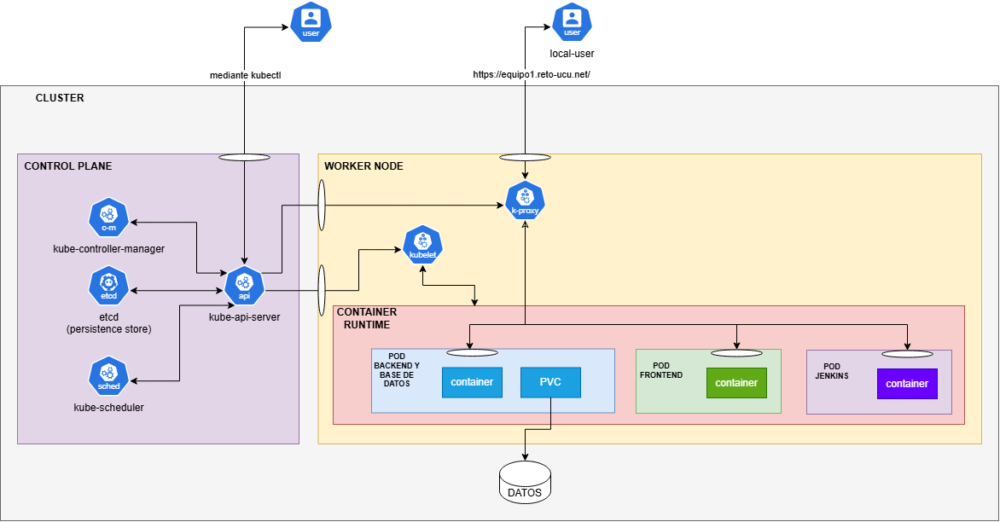

# Inventario del laboratorio

Aplicación para saber qué equipos hay en el laboratorio, dónde están, si alguien los está usando y reservarlos.

## Funcionalidades
- **Roles:** `usuario` (busca, toma, devuelve y reserva) y `encargado` (además da de alta equipos y cambia su estado).
- **Equipos** con nombre, tipo, ubicación y estado: `disponible`, `en uso`, `reservado`, `en reparación`.
- **Buscador** por nombre, tipo o ubicación.
- **Tomar y devolver** un equipo, **reservarlo para una fecha** e **historial** de quién lo usó.
- **Mapa del laboratorio** y **aviso de reservas vencidas**.

### Reglas
- Un equipo en uso o en reparación no se puede reservar.
- Solo quien tomó un equipo puede devolverlo, además del encargado.
- No puede haber dos reservas del mismo equipo para la misma fecha.
- Un equipo con reserva para hoy se muestra como `reservado`; solo quien lo reservó puede tomarlo.
- Dar de alta equipos y cambiar su estado es exclusivo del encargado.

## Arquitectura
Tres piezas, cada una en su propio pod:

    navegador ──► front (nginx) ──► back (Node + Express + SQLite)
                   archivos          API REST, JWT en cookie,
                   estáticos         base en un volumen (PVC)

    jenkins (+ docker-in-docker) ──► prueba, construye, sube a Docker Hub y despliega

    .
    ├── back/        # API: server.js, db.js, pruebas (test/), Dockerfile
    ├── front/       # index.html, app.js, nginx.conf, Dockerfile
    ├── jenkins/     # imagen de Jenkins (Dockerfile + plugins.txt)
    ├── k8s/
    │   ├── app/     # front, back, volumen e ingress
    │   └── jenkins/ # Jenkins, su volumen y su configuración
    ├── scripts/     # abrir-app.sh, abrir-jenkins.sh
    ├── Jenkinsfile  # pipeline
    └── docker-compose.yml

> Nota
> Ver manifiestos k8s.

El front sirve la página y reenvía a `http://back:3000` las rutas de la API (`/login`, `/logout`, `/me`, `/equipos`, `/avisos`, `/health`).
La base es SQLite (`node:sqlite`, Node 24+), por eso el back es de **una sola réplica**. SQLite es una base de datos enmbebida; se llama en el mismo proceso que el back.

### API
| Método | Ruta | Quién |
|---|---|---|
| POST | `/login`, `/logout` | todos |
| GET | `/me`, `/avisos` | autenticado |
| GET | `/equipos?q=texto` | autenticado |
| POST | `/equipos` | encargado |
| PATCH | `/equipos/:id/estado` | encargado |
| POST | `/equipos/:id/tomar`, `/devolver`, `/reservar` | autenticado |
| GET | `/equipos/:id/historial` | autenticado |
| GET | `/health` | público |

## Correr en local
Con Docker (front + back):

    docker compose up --build        # http://localhost:3000

Solo el back, sin Docker:

    cd back && npm ci && npm start   # API en http://localhost:3000
    npm test                         # 3 pruebas de las reglas principales

Los datos viven en el volumen `labdata`. `docker compose down -v` los borra.

### Variables de entorno (back)
| Variable | Por defecto | Uso |
|---|---|---|
| `PORT` | `3000` | puerto |
| `DB_PATH` | `./lab.db` | archivo SQLite |
| `JWT_SECRET` | secreto de desarrollo | cambiar siempre en producción |

### Usuarios de prueba (semilla)
`ana` / `ana123` y `luis` / `luis123` (usuario); `encargado` / `admin123` (encargado).
Cambiarlos o borrarlos antes de exponer la app fuera de una demo.

## Kubernetes (namespace `alumno-team1`)
| Archivo | Qué hace |
|---|---|
| `k8s/app/back-deployment.yaml`, `back-service.yaml`, `back-pvc.yaml` | API; volumen de 1 Gi en `/data` (`Recreate`, 1 réplica) |
| `k8s/app/front-deployment.yaml`, `front-service.yaml` | nginx con la página |
| `k8s/app/ingress.yaml` | entrada por dominio (`equipo1.reto-ucu.net`, clase `apisix`) hacia el front |
| `k8s/jenkins/*` | Jenkins con un contenedor docker-in-docker, volumen de 2 Gi y su configuración |
| `k8s/secret.yaml.example`, `k8s/jenkins-secrets.yaml.example` | plantillas de secretos (los reales no se versionan) |

Imágenes en Docker Hub (`linux/amd64`, la arquitectura de los nodos): `rperdomo4/lab-back`, `rperdomo4/lab-front`, `rperdomo4/lab-jenkins`.

### Persistencia
La base está en un PVC (`local-path`). Sobrevive a reiniciar o borrar el pod y a actualizar la imagen.
Se pierde si se borra el PVC o el namespace, o si cae el nodo (el almacenamiento es local al nodo).
Para varias réplicas del back habría que migrar `back/db.js` a Postgres.

### Puesta en marcha de Jenkins (una sola vez)

> Nota
> Jenkins es el encargado de desplegar la app al Clúster de la UCU al momento de hacer push a la rama main.

> Nota
> Usar los comandos en Git Bash.

Requiere `kubectl`, tu `team1.kubeconfig` y una sesión de `docker login`.

    # 1. Imagen de Jenkins
    docker buildx build --platform linux/amd64 -t rperdomo4/lab-jenkins:1.0 --push ./jenkins

    # 2. Secretos (el token de Docker Hub se crea en hub.docker.com con permiso Read & Write)
    export KUBECONFIG=ruta/al/team1.kubeconfig
    kubectl create secret generic lab-inventario -n alumno-team1 \
      --from-literal=JWT_SECRET=$(openssl rand -hex 32)          # omitir si ya existe
    kubectl create secret generic jenkins-secrets -n alumno-team1 \
      --from-literal=JENKINS_ADMIN_USER=admin \
      --from-literal=JENKINS_ADMIN_PASSWORD='<clave>' \
      --from-literal=DOCKERHUB_USER=rperdomo4 \
      --from-literal=DOCKERHUB_TOKEN='<token>'

    # 3. Desplegar Jenkins
    kubectl apply -n alumno-team1 -f k8s/jenkins/

    # 4. Abrir Jenkins en http://localhost:8081
    ./scripts/abrir-jenkins.sh

### Pipeline (`Jenkinsfile`)
Jenkins revisa el repo (rama `main`) cada pocos minutos y ejecuta:
1. **Tests del back** (`npm ci` y `npm test`).
2. **Construir** las imágenes `lab-back` y `lab-front`, etiquetadas con el número de build y `latest`.
3. **Subir** las imágenes a Docker Hub.
4. **Desplegar:** aplica `k8s/app/` con el tag nuevo y espera a que los pods queden listos.

Jenkins usa la cuenta de servicio `team1` del pod, así que no guarda ningún kubeconfig.

### Para conseguir el usuario y contraseña para Jenkins

> Nota
> Usar los comandos en Git Bash.

    export KUBECONFIG=/ruta/al/team1.kubeconfig
    kubectl get secret jenkins-secrets -n alumno-team1 -o jsonpath='{.data.JENKINS_ADMIN_USER}' | base64 -d
    kubectl get secret jenkins-secrets -n alumno-team1 -o jsonpath='{.data.JENKINS_ADMIN_PASSWORD}' | base64 -d

    # Abrir Jenkins en http://localhost:8081
    ./scripts/abrir-jenkins.sh

### Acceso por dominio
El Ingress (`ingressClassName: apisix`) publica la app en **https://equipo1.reto-ucu.net**, sin kubeconfig ni `port-forward`.

> El certificado del cluster es un comodín (`*.reto-ucu.net`) administrado por la cátedra. Si está vencido, el navegador
> mostrará una advertencia de seguridad; no es un problema de este proyecto y se arregla renovando ese certificado.

## Seguridad
- El kubeconfig es una **credencial**: no se sube al repo (`*.kubeconfig` está en `.gitignore`) y no se comparte por canales públicos. Guardarlo fuera del proyecto, por ejemplo en `~/.kube/`.
- Los secretos reales (`JWT_SECRET`, `jenkins-secrets`) se crean con `kubectl create secret` y nunca se versionan.
- El contenedor docker-in-docker de Jenkins corre con `privileged: true`; es necesario para construir imágenes dentro del cluster.

## Documento de arquitectura: Sistema de Inventario del Laboratorio
## 1. Descripción general
El sistema de Inventario del Laboratorio permite gestionar los equipos disponibles, consultar su ubicación y estado, registrar su utilización y devolución, y administrar reservas. Además, proporciona un historial de movimientos y avisos sobre reservas vencidas.

La aplicación contempla dos roles: usuario, que puede consultar y utilizar equipos, y encargado, que también puede registrar equipos y modificar sus estados.
## 2. Arquitectura del sistema
Se utiliza una arquitectura monolítica, implementada como un único servicio con Node.js y Express. El frontend estático, desarrollado con HTML y JavaScript, se comunica con el servidor mediante una API REST.

El servidor centraliza la autenticación, la autorización por roles y las reglas de negocio. Los datos se almacenan en SQLite, mediante un módulo específico que concentra las consultas y la gestión de las tablas.

## 3. Seguridad y reglas de negocio
La autenticación se realiza mediante JWT almacenado en una cookie. Las rutas protegidas requieren una sesión válida, y las operaciones administrativas están limitadas al rol encargado.

El servidor valida las reglas principales: impedir reservas de equipos en uso o en reparación, evitar reservas duplicadas para una misma fecha y equipo, y restringir las devoluciones al usuario que tomó el equipo o al encargado. También controla las reservas del día y genera avisos de vencimiento.

## 4. Despliegue y persistencia
La aplicación se empaqueta mediante Docker y se despliega en Kubernetes. Se utiliza un Deployment con una réplica, un Service para el acceso interno y un PersistentVolumeClaim (PVC) montado en /data, donde reside el archivo SQLite.

El volumen permite conservar los datos al reiniciar o reemplazar el pod. Sin embargo, al utilizar almacenamiento local al nodo, no se garantiza la recuperación ante la pérdida de dicho nodo. La configuración de una sola réplica evita que varias instancias escriban simultáneamente sobre el mismo archivo SQLite. Si se necesitara escalar horizontalmente, sería conveniente migrar a PostgreSQL.

El endpoint /health permite verificar el estado básico de la aplicación y utilizar comprobaciones de salud en Kubernetes. El acceso externo mediante Ingress queda sujeto a completar su configuración y verificar el dominio y la clase de Ingress del clúster.

